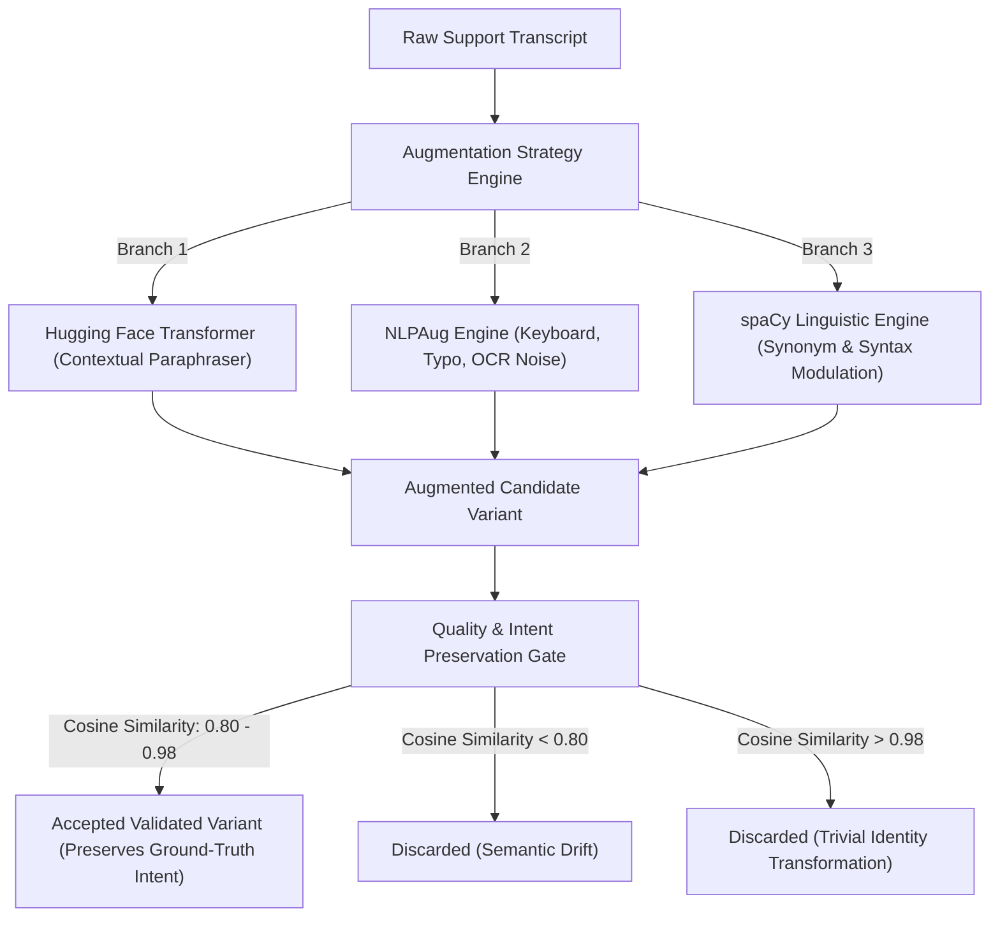

# Support Transcript Dataset & Augmentation Specification
**Project:** IntentAugment AI: Support Transcript Augmenter  
**Deliverable:** #1 (Week 1 Milestone)  
**Author:** Abhishek Manek  
**Repository:** `abhishekmanek-coder/intentaugment-ai--su_6afa9f795e1825889864aa7c_1795340608`  
**Evaluation Weight:** 10% (Support Transcript Dataset Analysis & Requirements)

---

## 1. Executive Summary & Problem Formulation

### 1.1 Problem Statement
Customer support intent classification is a foundational task in automated conversational AI. However, real-world customer support channels (live web chat, mobile messaging, email, and automated speech-to-text transcripts) exhibit severe distributional divergence from static training datasets. While reference training sets are typically curated with grammatical, fluent, and well-punctuated English, real customer interactions are characterized by:
- Severe typing errors (QWERTY adjacent-key typos, transpositions, character omissions).
- Grammatical compression (fragmented sentences, lack of capitalization and punctuation).
- Speech-to-text (STT) acoustic errors (homophone misspellings, phonetic slips, run-on phrases).
- Highly colloquial or emotionally charged phrasing (informal chat vernacular, urgency, frustration).

Standard intent classification models trained on narrow, static corpora degrade significantly when confronted with these noisy, real-world customer variants.

### 1.2 The IntentAugment AI Objective
**IntentAugment AI** is an automated, controlled natural language processing (NLP) augmentation framework designed to systematically expand support transcript training data while strictly safeguarding semantic integrity and intent label consistency.

By combining transformer-based contextual paraphrasing with realistic phonetic, typographical, and linguistic noise models, IntentAugment AI synthesizes robust, heterogeneous customer expressions that expand model decision boundaries and improve downstream intent classification robustness.

---

## 2. Baseline Dataset Analysis & Characterization

### 2.1 Dataset Composition
The baseline dataset (`raw_customer_support_transcripts.csv`) contains **200 verified customer support transcripts** systematically spanning **8 core business intent categories**:

| Intent Label | Domain Description | Sample Count | % Distribution |
| :--- | :--- | :---: | :---: |
| `refund_request` | Reimbursement, return credits, overcharge claims | 25 | 12.5% |
| `cancel_order` | Order revocation, dispatch abort, voiding pre-orders | 25 | 12.5% |
| `track_shipping` | Courier tracking, transit delays, package delivery status | 25 | 12.5% |
| `payment_issue` | Card declines, double billing, OTP timeouts, invoice errors | 25 | 12.5% |
| `account_recovery` | Password reset, 2FA lockout, unauthorized access, suspended account | 25 | 12.5% |
| `technical_support` | System crashes, API errors, 500 status codes, device incompatibilities | 25 | 12.5% |
| `subscription_management` | Plan upgrades/downgrades, auto-renewal cessation, seat licensing | 25 | 12.5% |
| `product_inquiry` | Specifications, hardware dimensions, compatibility, inventory | 25 | 12.5% |
| **Total** | **8 Primary Business Verticals** | **200** | **100.0%** |

The baseline maintains a strictly balanced prior distribution across classes, providing an unskewed foundation for controlled data augmentation.

### 2.2 Lexical & Structural Metrics
Computed via automated lexical analysis (`dataset_analysis.py`):
- **Total Utterances:** 200
- **Total Word Tokens:** 2,428
- **Unique Vocabulary Size:** 774 words
- **Lexical Diversity (Type-Token Ratio - TTR):** 0.3188 (healthy lexical variance without vocabulary saturation)
- **Mean Words per Utterance:** 12.14 words (Standard Deviation = 4.38 words)
- **Word Length Range:** [5 to 26 words]
- **Mean Characters per Utterance:** 71.60 characters

### 2.3 Modality & Channel Breakdown
Transcripts are gathered across three primary communication channels:
- **Live Chat (54%):** Characterized by short conversational turns, lower-case text, and rapid typing errors.
- **Email Support (28%):** Characterized by formal sentence structure, salutations, invoice numbers, and detailed explanations.
- **Voice Speech-to-Text (18%):** Characterized by run-on sentences, lack of casing/punctuation, and acoustic phonetic variations.

---

## 3. Customer Phrasing & Noise Assessment (Error Taxonomy)

Through systematic examination of customer chat logs, four dominant classes of linguistic perturbation have been identified and formalized into our noise taxonomy:

### 3.1 Typographical & Mechanical Noise (QWERTY Keyboard Distance)
- **Mechanism:** Customers typing rapidly on mobile virtual keyboards or physical keyboards strike adjacent keys.
- **Examples:**
  - *"cancel"* -> *"cancell"*, *"cancle"*, *"canvel"* (`v` is adjacent to `c`).
  - *"order"* -> *"ordrr"*, *"irder"* (`i` is adjacent to `o`).
- **Target Implementation:** `nlpaug.augmenter.char.KeyboardAug` with calibrated keyboard distance matrices.

### 3.2 Phonetic & Acoustic Transcription Artifacts
- **Mechanism:** Customers dictating via voice assistants or human transcription operators mishearing unstressed syllables or homophones.
- **Examples:**
  - *"their"* <-> *"there"*, *"too"* <-> *"two"*, *"won"* <-> *"one"*.
  - Contracted phonetic spellings: *"wuz"* for *"was"*, *"plz"* for *"please"*, *"gonna"* for *"going to"*.
- **Target Implementation:** Phonetic string perturbation and OCR/spelling distance noise (`nlpaug.augmenter.char.OcrAug`).

### 3.3 Syntactic & Grammatical Compression
- **Mechanism:** Chat-native users compress grammar by dropping subject pronouns, auxiliary verbs, or prepositions.
- **Examples:**
  - Reference: *"I would like to cancel my order before it ships."*
  - Compressed: *"cancel order asap before shipping"*.
  - Inverted Question: *"Why is shipping delayed?"* <-> *"any reason why the package isn't here yet?"*.
- **Target Implementation:** `spaCy` dependency tree perturbation (auxiliary verb pruning, passive/active voice inversion).

### 3.4 Contextual Synonymy & Paraphrasing
- **Mechanism:** Different customers express identical business intents using completely disjoint vocabularies.
- **Examples:**
  - `refund_request`: *"money back"* <-> *"reimbursement"* <-> *"credit funds back"* <-> *"reverse transaction"*.
  - `cancel_order`: *"terminate order"* <-> *"abort shipment"* <-> *"void purchase"* <-> *"revoke transaction"*.
- **Target Implementation:** Sequence-to-sequence transformer paraphrasers (`Vamsi/T5_Paraphrase_Paws`, `google/flan-t5-base`) operating under controlled beam search.

---

## 4. Augmentation Requirements & Quality Constraints

To prevent model corruption and ensure high-fidelity downstream training, the IntentAugment AI pipeline establishes strict boundaries:



### 4.1 Specification Constraints Table

| Dimension | Specification Constraint | Justification |
| :--- | :--- | :--- |
| **Expansion Factor (k)** | 4x (4 synthetic variants per raw sample) | Multiplies 200 raw samples into 1,000 balanced instances without overfitting. |
| **Noise Budget (alpha)** | Max 12% of characters or 15% of words | Prevents transcripts from becoming illegible gibberish. |
| **Semantic Similarity Floor** | Cosine Similarity >= 0.80 | Guards against intent drift (e.g. turning a cancellation into an order status query). |
| **Trivial Identity Ceiling** | Cosine Similarity <= 0.98 | Discards trivial identity transformations that add zero lexical diversity. |
| **Class Label Preservation** | Ground-truth intent remains strictly invariant | Ensures supervised training labels remain 100% consistent. |

---

## 5. NLP Environment Setup & Toolchain

The pipeline utilizes the following state-of-the-art NLP stack:

```plaintext
Python 3.10+ / 3.14 Environment
+-- transformers (Hugging Face)      --> Contextual Paraphrase generation (T5 / Pegasus)
+-- torch (PyTorch)                  --> Deep learning tensor execution engine
+-- nlpaug                           --> Character and keyboard typographical noise injection
+-- spacy (en_core_web_sm)           --> POS-tagging, lemmatization, and syntactic filtering
+-- sentence-transformers           --> Dense embeddings (all-MiniLM-L6-v2) for intent validation
+-- pandas & numpy                   --> Tabular data manipulation and matrix operations
+-- scikit-learn                     --> Downstream intent classification benchmarking
```

### Reproducibility Configuration
All random transforms, token perturbation rates, and beam search parameters are managed via a centralized YAML configuration (`configs/augmentation_config.yaml`) with deterministic random seeds (`seed=42`).

---

## 6. Initial Pipeline Architecture Design

The modular architecture for **Deliverable #2** is partitioned into four decoupled Python modules:

1. **`src/dataset_loader.py`**: Ingests, normalizes, and validates raw support transcripts from CSV/JSON.
2. **`src/paraphraser.py`**: Contextual paraphrasing module wrapping Hugging Face sequence-to-sequence pipelines.
3. **`src/noise_generator.py`**: Typo and acoustic noise synthesis wrapping NLPAug char and keyboard augmenters.
4. **`src/validator.py`**: Embeds pairs via Sentence-Transformers and executes cosine similarity thresholding.
5. **`src/pipeline.py`**: Unified orchestrator providing batch execution, progress telemetry, and structured metadata output.

---

## 7. Downstream Validation & Evaluation Plan

To empirically validate the efficacy of IntentAugment AI in Weeks 3 and 4:
1. **Baseline Model:** Train an intent classifier (TF-IDF + LinearSVC / LogisticRegression and DistilBERT) strictly on the raw 200 utterances.
2. **Augmented Model:** Train the identical model architecture on the expanded 1,000+ utterance augmented dataset.
3. **Robustness Stress Test:** Evaluate both models against an out-of-distribution test set containing real customer typos and noisy phone transcripts.
4. **Target Metric:** Demonstrate a >= 5-10% improvement in F1-score and accuracy on noisy customer queries.

---

## 8. Verification Checklist for Deliverable #1

- [x] Raw support transcript dataset prepared with 8 balanced intent classes (`raw_customer_support_transcripts.csv`).
- [x] Automated exploratory data analysis script implemented (`dataset_analysis.py`).
- [x] Lexical, structural, and channel metrics computed (`dataset_eda_summary.json`).
- [x] Comprehensive customer phrasing and error taxonomy documented.
- [x] Augmentation constraints and semantic similarity validation thresholds defined.
- [x] Complete NLP pipeline architecture specified with Mermaid diagrams and module contracts.
